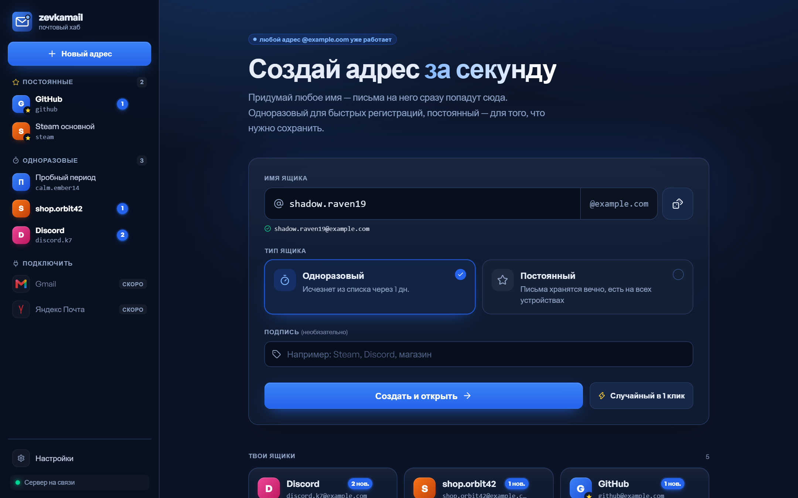
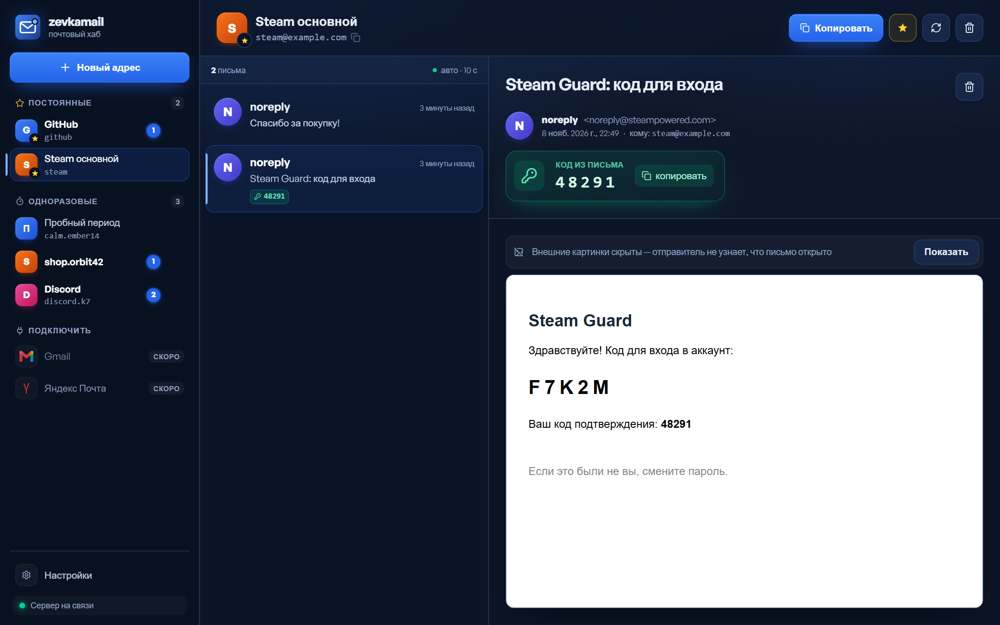
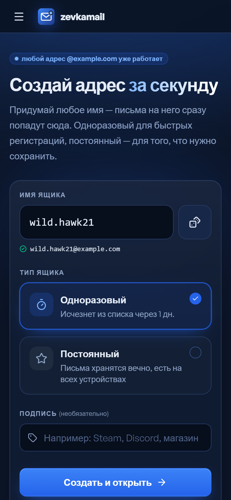
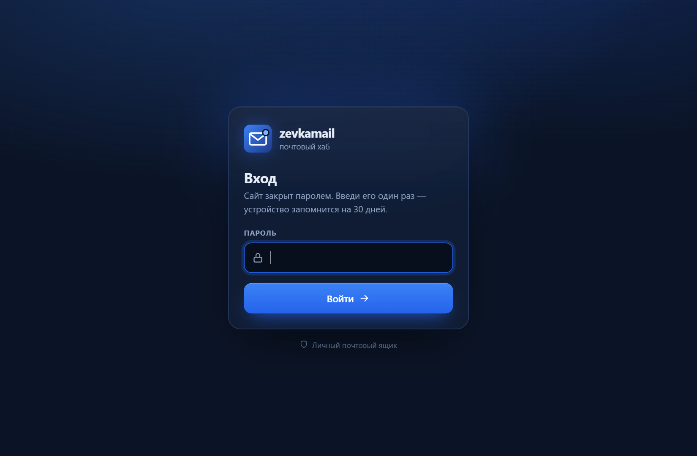

# zevkamail

[](https://github.com/roma67973-droid/zevkamail/actions/workflows/ci.yml)

Личный почтовый хаб с одноразовыми и постоянными ящиками на своём домене. Работает целиком на бесплатном тарифе Cloudflare: без VPS и без белого IP.

> **English summary.** zevkamail is a self-hosted personal email hub with disposable and permanent inboxes on your own domain. It runs entirely on the Cloudflare free tier: Email Routing delivers mail to a Worker, messages are stored in D1, and a SvelteKit UI on Workers reads them through a Service Binding. The whole site is locked behind a password, and the API is protected by a server-side key. It is a fork of [CloakMail](https://github.com/DreamsHive/cloakmail) (MIT) with a new Russian UI, server-synced mailboxes, permanent inboxes and security hardening.

## Скриншоты

| Главная | Ящик |
|---|---|
|  |  |

| Мобильная версия | Вход |
|---|---|
|  |  |

## Возможности

- Любой адрес на вашем домене принимает почту (catch-all), заводить ящики заранее не нужно.
- Одноразовые ящики: письма удаляются через заданный срок (по умолчанию 24 часа).
- Постоянные ящики: письма хранятся без срока.
- Список ящиков хранится на сервере и одинаков на всех устройствах.
- Код подтверждения из письма находится автоматически, копируется одним нажатием.
- Внешние картинки в письмах по умолчанию заблокированы (защита от трекинг-пикселей).
- Весь сайт закрыт паролем, API закрыт ключом.
- Только приём почты, отправки нет.

## Что сделано в форке

Основа — [CloakMail](https://github.com/DreamsHive/cloakmail). В форке переписан интерфейс и добавлено:

**Интерфейс**
- Новый тёмно-синий интерфейс на русском: боковая панель с разделами «Постоянные» и «Одноразовые», счётчики непрочитанных, список писем и панель чтения.
- Страница настроек, выбор акцентного цвета, мобильная версия с выдвижной панелью, собственные диалоги подтверждения вместо `confirm()`.
- Поиск кода подтверждения в теме и тексте письма с кнопкой копирования.
- HTML письма показывается в `iframe` с `sandbox` (без скриптов и same-origin) и CSP: внешние картинки, стили и шрифты блокируются до нажатия «показать картинки», `meta refresh` вырезается.

**Ящики**
- Постоянные ящики: письмам ставится `expires_at_ms = FOREVER`, ежедневная очистка их не трогает. Если ящик открепить, письма получают обычный срок жизни, отсчитанный с этого момента.
- Серверный список ящиков: таблица `mailboxes` в D1 (миграция `0002`), API `/api/mailboxes`.
- Синхронизация между устройствами: локальная копия и очередь изменений на случай недоступности сервера, отслеживание изменённых полей (`kind`, `label`), чтобы устаревшие данные одного устройства не затирали другое, последовательная очередь запросов по каждому адресу.
- Истечение сессии: при ответе 401 сайт переходит на страницу входа, несохранённые изменения ящиков не теряются.

**Безопасность и инфраструктура**
- Парольный вход на весь сайт (страницы и `/api/*`).
- Ключ API (`X-API-Key`), сравнение за постоянное время. Ключ подставляет веб-воркер, браузер его не видит.
- R2 необязателен: без него большие письма обрезаются примерно до 1,5 МБ и хранятся в D1.
- Деплой на бесплатный домен с Cloudflare Email Routing.
- Проверка типов, юнит-тесты и сборка под Cloudflare в GitHub Actions на каждый push и pull request (`.github/workflows/ci.yml`).

Вариант CloakMail на Docker/Redis/Elysia (`packages/server`, `docker-compose`) из форка убран: поддерживается только развёртывание на Cloudflare Workers.

## Архитектура

```
 Отправитель
     │ SMTP
     ▼
 MX вашего домена ── Cloudflare Email Routing (catch-all)
                              │
                              ▼
               ┌──────────────────────────────┐
               │ Worker cloakmail-api          │
               │  email()     postal-mime     │──► D1 (SQLite): emails, mailboxes
               │  fetch()     Hono REST API   │──► R2 (необязательно, тела >100 КБ)
               │  scheduled() cron 03:00 UTC  │    удаление просроченных писем
               └──────────────▲───────────────┘
                              │ Service Binding + X-API-Key
               ┌──────────────┴───────────────┐
               │ Worker cloakmail-web          │
               │  SvelteKit, парольный вход    │
               │  прокси /api/* → API          │
               └──────────────▲───────────────┘
                              │ HTTPS, сессионная кука
                           Браузер
```

1. Письмо приходит на MX домена, правило catch-all в Email Routing передаёт его воркеру `cloakmail-api`.
2. Обработчик `email()` разбирает MIME (`postal-mime`), отбрасывает спам (например, исполняемые вложения) и сохраняет письмо в D1. Адреса берутся из SMTP-конверта, а не из заголовков.
3. Тело больше 100 КБ при подключённом R2 уходит в R2, в D1 остаётся превью. Без R2 тело обрезается до ~1,5 МБ (лимит строки D1 — 2 МБ).
4. Cron раз в сутки удаляет письма с истёкшим `expires_at_ms`.
5. Веб-воркер принимает запросы браузера, проверяет сессию и проксирует `/api/*` в API через Service Binding, добавляя `X-API-Key`.

### REST API (`cloakmail-api`)

Все маршруты, кроме `/api/health`, требуют заголовок `X-API-Key`, если задан секрет `API_KEY`.

| Метод | Путь | Назначение |
|---|---|---|
| GET | `/api/inbox/:address?page=&limit=` | Письма ящика (`limit` до 50) |
| DELETE | `/api/inbox/:address` | Удалить все письма ящика |
| GET | `/api/email/:id` | Одно письмо целиком |
| DELETE | `/api/email/:id` | Удалить письмо |
| GET | `/api/mailboxes` | Сохранённые ящики |
| PUT | `/api/mailboxes/:address` | Создать/изменить ящик: `{ kind: "temp" \| "permanent", label, createdAt, ifAbsent, touch }` |
| DELETE | `/api/mailboxes/:address` | Убрать ящик из списка (письма остаются) |
| GET | `/api/health` | Состояние воркера и хранилища |

Пример:

```bash
curl -H "X-API-Key: $API_KEY" https://cloakmail-api.<your-subdomain>.workers.dev/api/inbox/test@example.com
```

## Стек

- Cloudflare Workers, Email Routing, D1 (SQLite), R2 (необязательно), Cron Triggers, Service Bindings
- API: TypeScript, [Hono](https://hono.dev), [postal-mime](https://github.com/postalsys/postal-mime)
- Веб: SvelteKit 2, Svelte 5 (runes), Tailwind CSS v4, `@sveltejs/adapter-cloudflare`
- Инструменты: Wrangler 4, Vitest

## Быстрый старт (локально)

Нужны Node.js и npm. Аккаунт Cloudflare и домен для локального запуска не нужны: Wrangler эмулирует Workers и D1.

```bash
# API
cd packages/cloudflare
npm install --legacy-peer-deps
cp wrangler.toml.example wrangler.toml
cp .dev.vars.example .dev.vars
npx wrangler d1 migrations apply DB --local
npx wrangler dev --local --port 8787

# Веб (во втором терминале)
cd packages/web
npm install --legacy-peer-deps
cp wrangler.toml.example wrangler.toml      # для локального запуска: PUBLIC_EMAIL_DOMAIN = "localhost"
cp .dev.vars.example .dev.vars
npm run build
npx wrangler dev --local --port 8788
```

Сайт: http://localhost:8788.

Проверки (из корня репозитория, после `npm install` в обоих пакетах):

```bash
npm run check   # svelte-check для веба, tsc для API
npm test        # юнит-тесты обоих пакетов
```

Подробности, эмуляция входящего письма и переменные окружения — в [docs/local-development.md](docs/local-development.md).

## Деплой

Кратко:

1. `wrangler login`, создать базу D1, вписать `database_id` в `packages/cloudflare/wrangler.toml`, применить миграции `--remote`.
2. Задать секрет `API_KEY` в обоих воркерах (одинаковый) и `SITE_PASSWORD` в веб-воркере.
3. Задеплоить `cloakmail-api`, затем `cloakmail-web`.
4. Добавить домен в Cloudflare, включить Email Routing, правило catch-all → воркер `cloakmail-api`.

Пошаговая инструкция: [docs/deploy.md](docs/deploy.md).

## Безопасность

- **Пароль на сайт.** Секрет `SITE_PASSWORD` закрывает все страницы и `/api/*`. Сессия — кука с HMAC-подписью на 30 дней (`HttpOnly`, `Secure`, `SameSite=Lax`). Ключ подписи — сам пароль, поэтому смена пароля разлогинивает все устройства. Неверный пароль отвечает с задержкой 1,5 с. Параметр `next` после входа принимает только пути этого же сайта (защита от open redirect). Выход — только POST.
- **Fail closed.** Если веб-воркер развёрнут без `SITE_PASSWORD`, он отвечает 503, а не открывает сайт. `ALLOW_OPEN_SITE=1` отключает эту проверку и предназначен только для локальной разработки.
- **Ключ API.** Секрет `API_KEY` защищает прямой доступ к API-воркеру (`*.workers.dev`) для скриптов и CLI. Браузер ключ не получает: его добавляет веб-воркер на сервере.
- **Письма.** HTML показывается в изолированном `iframe` с CSP, внешние ресурсы заблокированы по умолчанию, ссылки открываются в новой вкладке без referrer.

## Ограничения

- Только приём, отправки писем нет.
- Некоторые сайты не принимают адреса на бесплатных доменах.
- Без R2 тело письма больше ~1,5 МБ обрезается.
- Интеграционные тесты воркера из CloakMail (`packages/cloudflare/test/*.test.ts`, `@cloudflare/vitest-pool-workers` 0.6) сейчас не запускаются с новым `workerd`. Работают юнит-тесты (`npm test` в корне) и проверка типов (`npm run check`).
- `MAX_EMAIL_SIZE_MB` читается в конфигурации, но в варианте на Workers размер письма им не ограничивается (ограничения задаёт сам Email Routing).

## Структура проекта

```
.github/workflows/ci.yml        CI: типы, юнит-тесты, сборка
packages/
├── cloudflare/                 @zevkamail/api — Worker cloakmail-api
│   ├── src/
│   │   ├── worker.ts           точка входа: fetch / email / scheduled
│   │   ├── email.ts            приём письма, разбор MIME, спам-фильтр
│   │   ├── api.ts              REST API на Hono, проверка X-API-Key
│   │   ├── store.ts            работа с D1/R2, сроки хранения, ящики
│   │   ├── spam.ts, config.ts, types.ts, utils/
│   ├── migrations/             0001_init.sql (emails), 0002_mailboxes.sql
│   ├── test/                   интеграционные тесты (vitest-pool-workers)
│   ├── test/unit/              юнит-тесты в Node (обрезка тел писем)
│   ├── wrangler.toml.example
│   └── .dev.vars.example
└── web/                        @zevkamail/web — Worker cloakmail-web (SvelteKit)
    ├── src/
    │   ├── hooks.server.ts     парольный вход и прокси /api/* в API
    │   ├── lib/server/gate.ts  сессии, страница входа
    │   ├── lib/stores/         hub.svelte.ts (ящики, синхронизация, настройки), dialog.svelte.ts
    │   ├── lib/components/hub/ боковая панель, диалоги, аватары
    │   ├── lib/utils/          утилиты и их юнит-тесты
    │   └── routes/             /, /inbox/[address], /settings
    ├── wrangler.toml.example
    └── .dev.vars.example
```

## Авторы и лицензия

Проект основан на [CloakMail](https://github.com/DreamsHive/cloakmail) от DreamsHive, распространяемом по лицензии MIT. Форк сохраняет исходную лицензию: см. [LICENSE](LICENSE) (Copyright (c) 2025 DreamsHive). Изменения в форке распространяются на тех же условиях MIT.
